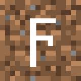

# DigammaXR (ARCHIVED)



⚠️ This project is archived. Development has ended. The last released version remains available for download.

DigammaXR is a Vivecraft fork that makes Minecraft Java VR playable on Intel Arc graphics through Virtual Desktop.

## Summary

The only simple way to play Minecraft Java in VR on Intel Arc graphics cards.

## Description

Play Minecraft in VR with tracked hands, motion controls, joystick movement, snap turning, room-scale interaction, VR menus, inventory controls, teleporting, and comfort settings. DigammaXR connects directly to Virtual Desktop's VDXR OpenXR runtime instead of using SteamVR or OpenVR.

The current release targets Fabric and Minecraft 1.20.4. The project is still being improved, so hardware or mod combinations outside the tested setup may need additional compatibility work.

## Supported version

- Minecraft Java Edition 1.20.4
- Fabric Loader
- Java 17
- Windows
- Virtual Desktop with VDXR selected
- Meta Quest 3S with Touch Plus controllers

Sodium is optional.

Do not install DigammaXR and Vivecraft in the same Minecraft instance.

## Installation

1. Install Fabric Loader for Minecraft 1.20.4.
2. Put the DigammaXR JAR in the instance's `mods` folder.
3. Select VDXR as the OpenXR runtime in Virtual Desktop Streamer.
4. Connect the headset through Virtual Desktop.
5. Start Minecraft.

DigammaXR is client-side and does not need to be installed on a vanilla server.

## Default controls

| Controller input | Action |
| --- | --- |
| Left thumbstick | Move |
| Right thumbstick | Snap turn |
| Right trigger | Attack |
| Left trigger | Use or interact |
| A | Jump fallback |
| X | Game menu |
| Y | Inventory |
| Left grip | Sneak |
| Right grip | Next hotbar slot |

## Building from source

The Gradle Wrapper is included, so a separate Gradle installation is not required. An internet connection is needed the first time Gradle downloads Minecraft and the build dependencies.

Use a 64-bit JDK 17, open PowerShell in the Fabric source directory, and run:

```powershell
.\gradlew.bat :fabric:build --no-daemon
```

The distributable mod is created in `fabric/build/libs`. Use `DigammaXR-10.0.0-fabric.jar`, not the development or `dev-shadow` JAR.

## Reporting problems

Include the Minecraft log or crash report, GPU model, headset and controller model, Virtual Desktop version, confirmation that VDXR is selected, installed mod list, and clear reproduction steps.

## Credits and license

DigammaXR is a fork of [Vivecraft](https://github.com/Vivecraft/VivecraftMod). The inherited VR rendering, gameplay, GUI, locomotion, networking, and compatibility systems originate from the Vivecraft project. See `DIGAMMAXR_NOTICE.md` for detailed attribution.

DigammaXR is licensed under the [GNU Lesser General Public License v3.0 or later](LICENSE.md). It is not an official release from Vivecraft, Mojang, Microsoft, Meta, Intel, or Virtual Desktop.
